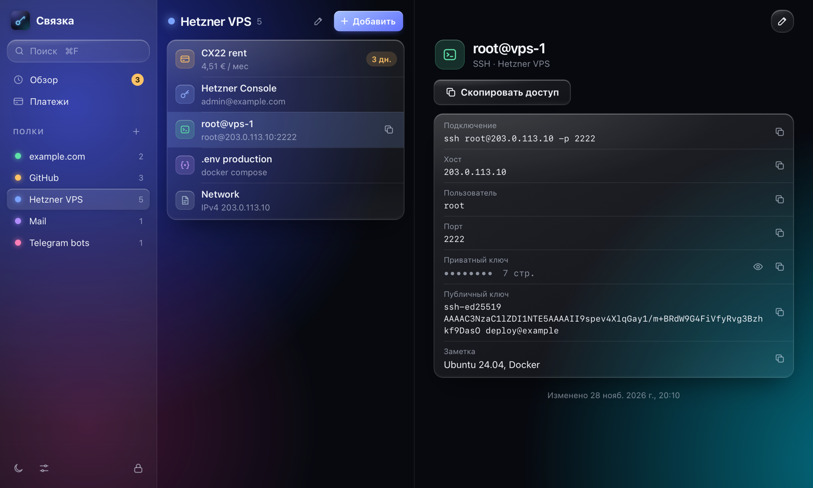

# Svyazka

**A local, encrypted keyring for macOS, Windows and Linux that AI coding agents can use — without seeing your secrets.**

[Русская версия](README.ru.md)



<details><summary>Light theme</summary>


</details>

Coding agents like Claude Code and Codex constantly need SSH keys, API tokens, `.env` files and passwords.
Usually they end up pasted into the chat, left in project files, or scattered across notes.
Svyazka keeps them in one encrypted vault on your computer and gives agents a way to **use** them without **reading** them:

```bash
svyazka ssh "prod/root@vps" -- 'docker ps'                 # key goes to ssh-agent for 15 min, never to disk
svyazka run "my-app/.env prod" -- docker compose up -d     # secrets become env vars of that process only
svyazka add token "Cloudflare API" --shelf my-app --value ask   # you type the value in a macOS dialog
```

If a command prints a secret, it is replaced with `•••`. Revealing a value (`svyazka get`) requires **your Touch ID or Windows Hello**.
Every access is logged with who did it — you, Claude or Codex.

## Features

- **Desktop app** — `Связка.app` on macOS, a Start-menu app on Windows (Edge app window), `svyazka ui` on Linux. Shelves (one per project or server), passwords, SSH keys, tokens, notes, upcoming payments for
  servers, domains and subscriptions. Three-pane layout, dark and light themes, ⌘F / ⌘N / ⌘L.
- **`svyazka` CLI + agent** — the key stays in memory like `ssh-agent`, auto-locks after 30 min idle.
- **Unlock with Touch ID / Windows Hello** — type the master password once; after that the app and the agents open
  Svyazka with your fingerprint (`svyazka config quick-unlock off` to disable).
- **Built for agents** — a skill for Claude Code and Codex, plus a standing rule: *any new secret goes into Svyazka
  immediately*. Generated a DB password, created a deploy key, received a token — the agent saves it and tells you where.
- **No server, no account** — AES-256-GCM, key derived from your master password (PBKDF2-SHA256, 600k iterations).
  The vault is a single file, `~/.svyazka/vault.json`.
- **Backup and multiple computers** — `svyazka sync` writes an encrypted copy to a folder (iCloud Drive / OneDrive by default)
  and merges changes from your other computers.
- **Works over SSH too** — with no GUI session, passwords and confirmations are asked in the terminal.

## Install

Requirements: Node.js 20+ and
- **macOS** 13+ with Xcode Command Line Tools (`xcode-select --install`),
- **Windows** 10/11 (OpenSSH client for `svyazka ssh`; Windows Hello recommended),
- **Linux** — terminal prompts, or `zenity` for dialogs; `wl-copy`/`xclip` for the clipboard.

**Let your agent do it.** Download the latest [release](https://github.com/rdm9x/svyazka/releases), unzip, open Claude Code (or Codex) in the folder and say:

> Install Svyazka following AGENT_INSTALL.md

It checks requirements, installs everything, creates your vault, connects Codex if present and offers to move your
existing keys from `~/.ssh` and `.env` files — without printing their values.

**Or by hand:**

```bash
git clone https://github.com/rdm9x/svyazka && cd svyazka
sh install.sh        # macOS / Linux: `svyazka` in ~/.local/bin, app, skills for Claude Code and Codex
svyazka init         # create the vault — a dialog asks for the master password
```

Windows (PowerShell):

```powershell
git clone https://github.com/rdm9x/svyazka; cd svyazka
powershell -ExecutionPolicy Bypass -File install.ps1   # `svyazka`, Start-menu shortcut, skills
svyazka init
```

The installer adds a short block to `~/.claude/CLAUDE.md` and `~/.codex/AGENTS.md` between
`<!-- svyazka:begin/end -->` markers (the original file is backed up as `.bak-svyazka`).

## Using it

Open **Svyazka** from Spotlight (Mac) or the Start menu (Windows), or run `svyazka ui`. In Claude Code or Codex just ask: “connect to the prod server”,
“deploy with the tokens from Svyazka”, “generate a password for the new database”.

| Command | What it does |
|---|---|
| `svyazka ls [shelf]`, `find <text>`, `show <item>` | list and search — secrets stay hidden |
| `svyazka add <type> <title> --shelf S [--field value]…` | add an item. Secrets only via `gen`, `@file`, `-` (stdin) or `ask` (dialog) — never as plain arguments |
| `svyazka run <item> [--env NAME=field] -- cmd` | run a command with secrets in its environment; output is redacted |
| `svyazka ssh <item> [-- cmd]`, `ssh-add <item>` | SSH with a key from the vault |
| `svyazka get` / `copy` / `rm` | reveal, copy to clipboard (cleared after 30 s), delete — **Touch ID / Windows Hello required** |
| `svyazka pay`, `paid <item>` | upcoming payments, mark as paid |
| `svyazka sync`, `config sync-dir <folder>` | encrypted backup and merge between your computers |
| `svyazka import <file>` | a Svyazka backup (merge) or plain JSON in the [import format](IMPORT.md) |
| `svyazka log`, `status`, `lock` | audit log, state, lock now |

Item types: `password`, `ssh`, `token` (a value or a whole `.env`), `payment`, `note`. `svyazka help` for details.

### Codex

Codex runs commands in a sandbox that blocks the Svyazka agent socket. The skill tells Codex to ask you to run
`svyazka` outside the sandbox — approve it (you can allow it permanently).

## Security

Read [SECURITY.md](SECURITY.md) for the full threat model. In short:

- **Protects against:** secrets leaking into agent chats, logs, commits and project files; a stolen or copied vault file;
  someone reading values off your screen without your fingerprint.
- **Does not protect against** malware running as your user while the vault is unlocked — like `ssh-agent`, any process
  of yours can talk to the agent. Output redaction is a safety net against accidents, not a sandbox: a determined
  program can still exfiltrate a value it was given.
- Not audited. Your master password cannot be recovered.

## Status

macOS, Windows and Linux. The interface is in Russian (English is next); an MCP server for other agents is planned —
see the [changelog](CHANGELOG.md). Windows dialogs and Windows Hello are tested by CI only up to the point where a
person has to click — feedback from Windows users is very welcome. Contributions welcome: [CONTRIBUTING.md](CONTRIBUTING.md).

## Uninstall

```bash
node ~/.svyazka/app/cli/agent-rules.mjs remove
rm -f ~/.local/bin/svyazka ~/.claude/skills/svyazka ~/.codex/skills/svyazka
rm -rf ~/Applications/Связка.app ~/.svyazka/app
```
Windows: `node $HOME\.svyazka\app\cli\agent-rules.mjs remove`, then delete `~\.svyazka\app`, `~\.svyazka\bin`,
`~\.claude\skills\svyazka`, `~\.codex\skills\svyazka` and the «Связка» Start-menu shortcut.
The vault (`~/.svyazka/vault.json`) is left in place — delete it only if you have a backup or don't need it.

## License

[MIT](LICENSE)
