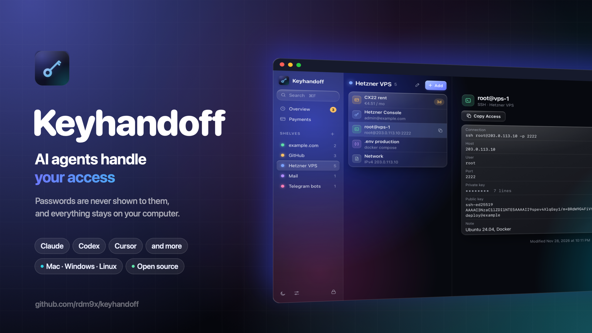
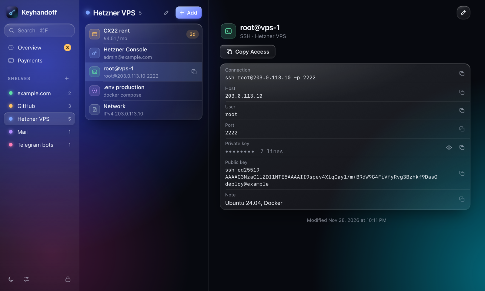
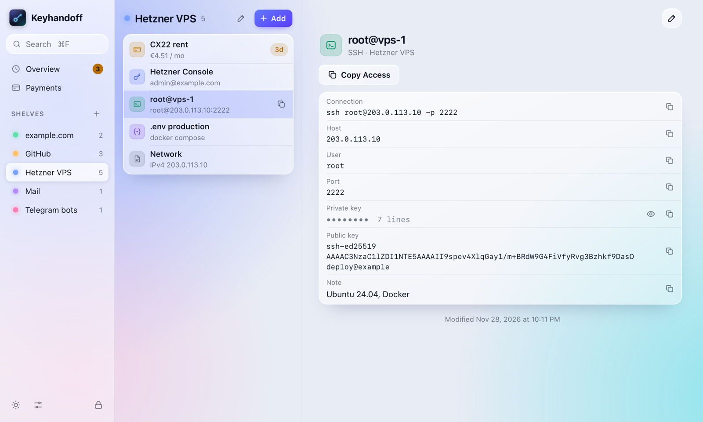

<p align="center">
  
</p>

<h1 align="center">Keyhandoff</h1>

<p align="center">
  <b>Your AI agents handle the keys — so you don't have to.</b><br>
  A local, encrypted keyring for Claude Code, Codex, Cursor and other agents.<br>
  They use your SSH keys, tokens and passwords and save new ones themselves — the values never show up in the chat.
</p>

<p align="center">
  <a href="https://github.com/rdm9x/keyhandoff/releases/latest"></a>
  <a href="LICENSE"></a>
  
  <a href="https://github.com/rdm9x/keyhandoff/actions/workflows/ci.yml"></a>
</p>

<p align="center">
  <a href="#install">Install</a> ·
  <a href="#how-the-ai-uses-a-key-without-seeing-it">How it works</a> ·
  <a href="SECURITY.md">Security</a> ·
  <a href="CONSTITUTION.md">Principles</a> ·
  <a href="README.ru.md">Русский</a>
</p>

<p align="center">
  
</p>

## Stop being your agent's courier

Every day your agent asks for something: the SSH key to prod, a Cloudflare token, the database password, the `.env`
for staging. So you dig through notes, paste it into the chat, and a week later can't remember where the agent saved
the new password it generated.

With Keyhandoff that just stops:

```text
You     Deploy the backend to prod.
Claude  Using the "VPS / root@prod" access from Keyhandoff…
        $ keyhandoff ssh "VPS/root@prod" -- ./deploy.sh
        Done — the server is updated ✓
        I created a new database password and saved it to the "VPS" shelf.
```

You didn't look anything up, didn't paste anything, didn't write anything down. And the password itself never
appeared in the chat — not on the way in, not on the way out.

*Keys get handed off between you and your agents — hence the name. In Russian it's called «Связка», a bunch of keys.*

## What you get

|  |  |
|---|---|
| 🤝 **Agents do the routine** | They find the right access, run commands and SSH with it, and file every new key on the right shelf. A standing rule tells them: *any new secret goes into Keyhandoff immediately*. |
| 🙈 **Values never reach the chat** | Agents work with names; secrets go straight into the command and are scrubbed from its output. There is no command or MCP tool that hands a value to an agent. |
| 👆 **You have the last word** | Revealing, copying or deleting a value takes your Touch ID or Windows Hello. The menu bar key blinks when an agent uses access, and the log shows who took what. |
| 💻 **Everything stays on your computer** | One encrypted file. No server, no account, no subscription, no telemetry. Optional sync through your own iCloud Drive / OneDrive folder. |
| ⚡ **Zero setup** | One line to install — or just ask your agent to do it. Move in from Bitwarden, 1Password, KeePassXC or your browser with one command. |
| 🗓 **Payments, too** | Keep what your VPSs, domains and subscriptions cost and when they're due — Keyhandoff shows what's coming up. |

<p align="center">
  
</p>

<details><summary>Light theme</summary>



</details>

## Works with

| Agent | How |
|---|---|
| **Claude Code** | skill + standing rule in `~/.claude/CLAUDE.md` — set up by the installer |
| **Codex** | skill + rule in `~/.codex/AGENTS.md` — set up by the installer |
| **Cursor, Claude Desktop, Gemini CLI** and any MCP client | `keyhandoff mcp` — [setup below](#cursor-claude-desktop-gemini-cli-and-other-agents-mcp) |
| **You** | the desktop app, the menu bar key and the `keyhandoff` command (`kh` for short) |

## Install

macOS 13+, Windows 10/11 or Linux (x64 / arm64). Nothing to install first.

**Easiest — ask your agent.** In Claude Code or Codex say:

> Install Keyhandoff from github.com/rdm9x/keyhandoff

It installs everything, creates your vault and offers to move your existing keys from `~/.ssh` and `.env` files —
without printing their values ([what it follows](AGENT_INSTALL.md)).

**macOS / Linux** — one line in Terminal:

```bash
curl -fsSL https://github.com/rdm9x/keyhandoff/releases/latest/download/install.sh | sh
```

**Windows** — PowerShell:

```powershell
irm https://github.com/rdm9x/keyhandoff/releases/latest/download/install.ps1 -OutFile $env:TEMP\svyazka-install.ps1
powershell -ExecutionPolicy Bypass -File $env:TEMP\svyazka-install.ps1
```

Then create the vault: `keyhandoff init` (a dialog asks for the master password). From now on, just talk to your agent:
“connect to the prod server”, “deploy with the tokens from Keyhandoff”, “generate a password for the new database”.

<details><summary>Details: Node.js, updates, installing from a clone</summary>

If Node.js 20+ is missing, the installer downloads it from nodejs.org (checksum-verified) into `~/.svyazka/node` —
a private copy for Keyhandoff only. On a Mac the Touch ID helper and the app come prebuilt in the release, so Xcode and
its Command Line Tools are not needed.

**Updating:** `keyhandoff update` (on a Mac also the menu bar key → “Update Keyhandoff”, which appears when a new version is
out). The release is checked against the author's Ed25519 signature before anything is installed; the vault is never
touched. Versions before 2.0 update once by running the install line above again.

From a git clone: `sh install.sh` (macOS / Linux) or `powershell -ExecutionPolicy Bypass -File install.ps1` (Windows).
A clone has no prebuilt Mac programs, so there they are compiled — that needs Command Line Tools (`xcode-select --install`).

Optional extras: OpenSSH client for `keyhandoff ssh` on Windows (Windows Hello recommended); on Linux `zenity` for dialogs
and `wl-copy`/`xclip` for the clipboard.

The installer adds a short block to `~/.claude/CLAUDE.md` and `~/.codex/AGENTS.md` between
`<!-- svyazka:begin/end -->` markers (the original file is backed up as `.bak-svyazka`).

</details>

## How the AI uses a key without seeing it

The most common question: “if Claude uses my keys, doesn't it see them?” Not when it works through Keyhandoff:

1. **The agent works with names.** `keyhandoff ls`, `find`, `show` list shelves, items, hosts and logins; secrets show up
   only as a marker that they exist (`🔒password`).
2. **Secrets go straight into the command.** `keyhandoff run "Project/.env prod" -- docker compose up -d` — Keyhandoff
   starts the command itself and puts the values into its environment. They never appear in the chat, in arguments
   or on disk. `keyhandoff ssh` hands the key to `ssh-agent` for 15 minutes, also bypassing the disk.
3. **Output is scrubbed.** If the command prints a secret anyway (say, `env` or an error containing a token),
   Keyhandoff replaces it with `•••` before the agent sees the text.
4. **New keys stay hidden too.** Passwords are generated inside Keyhandoff (`--password gen`), values come from a file
   (`@path`) or another command's output (`-`), and if only you have the key, the agent asks you to paste it into a
   system dialog (`ask`). Passing a secret as a plain argument is refused.
5. **Only a person can reveal a value.** `keyhandoff get` / `copy` need your Touch ID or Windows Hello, and every access
   is logged (`keyhandoff log`) with who did it — you, Claude, Codex or an MCP client.

```bash
keyhandoff ssh "prod/root@vps" -- 'docker ps'                      # key goes to ssh-agent for 15 min, never to disk
keyhandoff run "my-app/.env prod" -- docker compose up -d          # secrets become env vars of that process only
keyhandoff add token "Cloudflare API" --shelf my-app --value ask   # you type the value in a system dialog
```

**Where the line is.** This protects against accidental leaks — into chat history, logs, commits, project files. It
does not stop an agent that *deliberately* wants to steal a key: a program given a secret via `run` can encode it
(`base64`) before printing or send it over the network. So keep an eye on which commands the agent runs with
secrets — they are all in the audit log. Details in [SECURITY.md](SECURITY.md).

## How is it different from…

- **1Password / Bitwarden CLI** (`op run`, `bw`) — great tools, but they need an account and a cloud vault, and
  nothing in them teaches an agent to file the new keys it creates. Keyhandoff is local-only and free, and built around
  the agent: a skill and a standing rule, secrets accepted only as `gen` / `ask` / `@file`, an audit log by caller.
  Moving in from either takes [one command](#commands).
- **Doppler, Infisical, HashiCorp Vault** — team secret managers with a server, roles and sharing. Keyhandoff is for one
  person and their computers, with nothing to host.
- **A `.env` file or notes** — plaintext, copied into every chat and commit. That's what Keyhandoff replaces.

## Commands

| Command | What it does |
|---|---|
| `keyhandoff ls [shelf]`, `find <text>`, `show <item>` | list and search — secrets stay hidden |
| `keyhandoff add <type> <title> --shelf S [--field value]…` | add an item. Secrets only via `gen`, `@file`, `-` (stdin) or `ask` (dialog) — never as plain arguments |
| `keyhandoff run <item> [--env NAME=field] -- cmd` | run a command with secrets in its environment; output is redacted |
| `keyhandoff ssh <item> [-- cmd]`, `ssh-add <item>` | SSH with a key from the vault |
| `keyhandoff get` / `copy` / `rm` | reveal, copy to clipboard (cleared after 30 s), delete — **Touch ID / Windows Hello required** |
| `keyhandoff pay`, `paid <item>` | upcoming payments, mark as paid |
| `keyhandoff sync`, `config sync-dir <folder>` | encrypted backup and merge between your computers |
| `keyhandoff import <file>` | a Keyhandoff backup (merge), JSON in the [import format](IMPORT.md), or an export from Bitwarden, 1Password, KeePassXC, Chrome / Edge / Firefox / Safari |
| `keyhandoff export <file>` | for another manager: `.json` (Bitwarden, all items) or `.csv` (passwords) — after Touch ID, unencrypted |
| `keyhandoff log`, `status`, `lock` | audit log, state, lock now |
| `keyhandoff update [--check]` | update to the latest signed release |
| `keyhandoff mcp`, `mcp config` | MCP server for Cursor, Claude Desktop, Gemini CLI; the snippet for their settings |
| `keyhandoff config lang en\|ru\|auto` | interface language (auto — by the system) |

Item types: `password`, `ssh`, `token` (a value or a whole `.env`), `payment`, `note`. `keyhandoff help` for details.

<details><summary>All features</summary>

- **Menu bar key** (macOS) — a key icon next to the clock that blinks when an AI agent uses a key (lavender) or saves
  one (green); click it for the latest agent actions, open or lock Keyhandoff. Closing the window keeps it there.
- **Desktop app** — Keyhandoff in Applications on macOS, a Start-menu app on Windows (Edge app window), `keyhandoff ui` on Linux.
  Shelves (one per project or server), passwords, SSH keys, tokens, notes, upcoming payments for servers, domains and
  subscriptions. Dark and light themes, ⌘F / ⌘N / ⌘L.
- **`keyhandoff` CLI + agent** — the key stays in memory like `ssh-agent`, auto-locks after 30 min idle.
- **Unlock with Touch ID / Windows Hello** — type the master password once; after that the app and the agents open
  Keyhandoff with your fingerprint (`keyhandoff config quick-unlock off` to disable).
- **Encryption** — AES-256-GCM, key derived from your master password (PBKDF2-SHA256, 600k iterations). The vault is
  a single file, `~/.svyazka/vault.json`.
- **Backup and multiple computers** — `keyhandoff sync` writes an encrypted copy to a folder (iCloud Drive / OneDrive by
  default) and merges changes from your other computers.
- **Move in and out** — import from Bitwarden, 1Password, KeePassXC and browsers; notes and 2FA secrets land in hidden
  fields agents never see. Export back to Bitwarden JSON or CSV.
- **Signed updates** — `keyhandoff update` installs only releases signed with the author's Ed25519 key.
- **Works over SSH too** — with no GUI session, passwords and confirmations are asked in the terminal.
- **English and Russian** — by your system language; `keyhandoff config lang en|ru` or Settings → Language.

</details>

### Codex

Codex runs commands in a sandbox that blocks the Keyhandoff agent socket. The skill tells Codex to ask you to run
`keyhandoff` outside the sandbox — approve it (you can allow it permanently).

### Cursor, Claude Desktop, Gemini CLI and other agents (MCP)

`keyhandoff mcp` is an MCP server with the same rules: the agent can list and search items, run commands and SSH with
secrets, save new secrets (`gen`, `ask` or `@file` only) and see payments — there is no tool that returns a value.
Print the settings snippet and paste it into the client's MCP config:

```bash
keyhandoff mcp config
```

| Client | Where |
|---|---|
| Cursor | `~/.cursor/mcp.json` |
| Claude Desktop | Settings → Developer → Edit Config (`claude_desktop_config.json`) |
| Gemini CLI | `~/.gemini/settings.json` |
| Claude Code | not needed — it uses the skill; or `claude mcp add keyhandoff -- keyhandoff mcp` |

The log shows such calls as `MCP: <client name>`.

## Security

Read [SECURITY.md](SECURITY.md) for the full threat model. In short:

- **Protects against:** secrets leaking into agent chats, logs, commits and project files; a stolen or copied vault file;
  someone reading values off your screen without your fingerprint.
- **Does not protect against** malware running as your user while the vault is unlocked — like `ssh-agent`, any process
  of yours can talk to the agent. Output redaction is a safety net against accidents, not a sandbox.
- Not audited. Your master password cannot be recovered.

## Principles

Keyhandoff grows by a short [constitution](CONSTITUTION.md): values never reach the agent, a person has the last word,
you are not the courier, everything stays with you, zero setup, small and readable code, honesty about limits.
Feature ideas are checked against it — please read it before opening a PR.

## Status and contributing

macOS, Windows and Linux; English and Russian interface. See the [changelog](CHANGELOG.md). Windows dialogs and
Windows Hello are tested by CI only up to the point where a person has to click — feedback from Windows users is very
welcome. Issues and PRs: [CONTRIBUTING.md](CONTRIBUTING.md). If Keyhandoff saves you time, a ⭐ helps others find it.

## Uninstall

```bash
$(command -v node || echo ~/.svyazka/node/bin/node) ~/.svyazka/app/cli/agent-rules.mjs remove
rm -f ~/.local/bin/keyhandoff ~/.local/bin/kh ~/.local/bin/svyazka ~/.claude/skills/svyazka ~/.codex/skills/svyazka
rm -rf ~/Applications/Связка.app ~/.svyazka/app ~/.svyazka/node ~/Library/LaunchAgents/local.svyazka.menubar.plist
```
Windows: `node $HOME\.svyazka\app\cli\agent-rules.mjs remove`, then delete `~\.svyazka\app`, `~\.svyazka\bin`, `~\.svyazka\node`,
`~\.claude\skills\svyazka`, `~\.codex\skills\svyazka` and the Keyhandoff Start-menu shortcut. The app file on a Mac is `Связка.app` — its Russian name.
The vault (`~/.svyazka/vault.json`) is left in place — delete it only if you have a backup or don't need it.

## License

[MIT](LICENSE)
