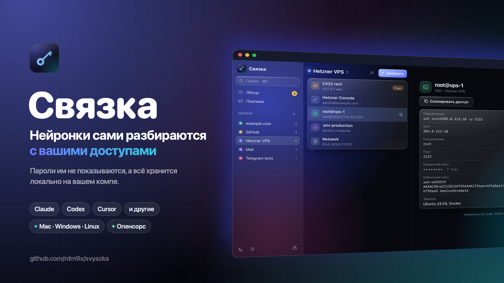
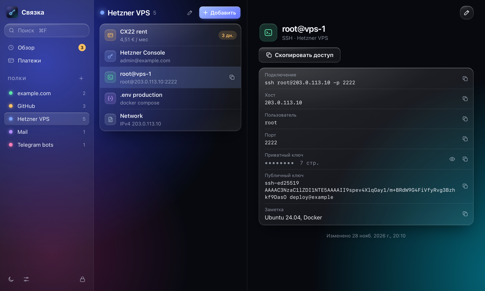
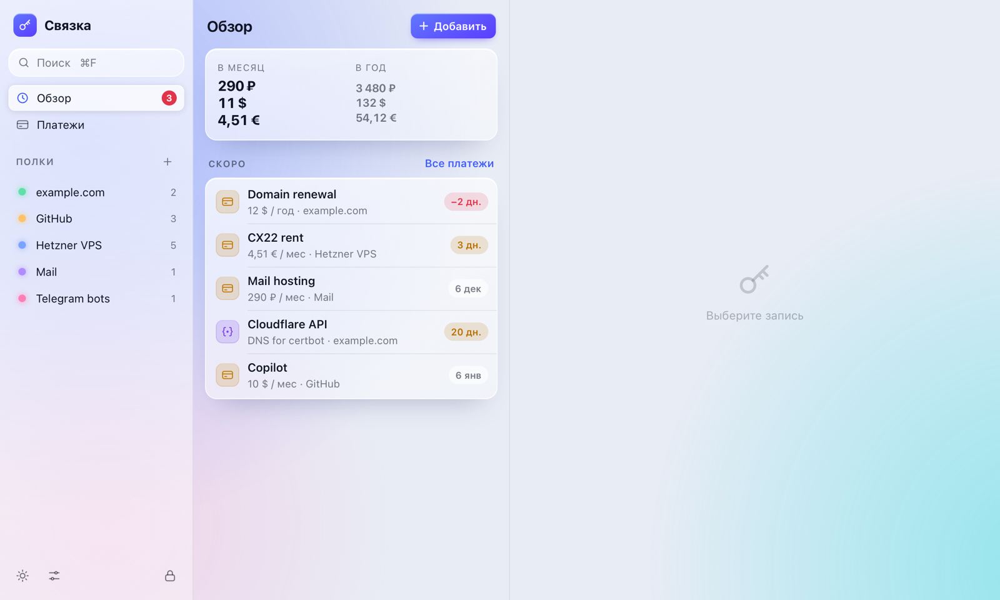

<p align="center">
  
</p>

<h1 align="center">Связка</h1>

<p align="center">
  <b>Нейронки сами разбираются с доступами — вам больше не нужно.</b><br>
  Локальная зашифрованная ключница для Claude Code, Codex, Cursor и других агентов.<br>
  Они пользуются вашими SSH-ключами, токенами и паролями и сами сохраняют новые, но сами пароли им не показываются.
</p>

<p align="center">
  <a href="https://github.com/rdm9x/keyhandoff/releases/latest"></a>
  <a href="LICENSE"></a>
  
  <a href="https://github.com/rdm9x/keyhandoff/actions/workflows/ci.yml"></a>
</p>

<p align="center">
  <a href="#установка">Установка</a> ·
  <a href="#как-нейронка-не-видит-ключи">Как это работает</a> ·
  <a href="SECURITY.md">Безопасность</a> ·
  <a href="CONSTITUTION.ru.md">Принципы</a> ·
  <a href="README.md">English (Keyhandoff)</a>
</p>

<p align="center">
  
</p>

## Хватит быть курьером для нейронки

Каждый день агент что-то просит: SSH-ключ от прода, токен Cloudflare, пароль от базы, `.env` для стейджа. Вы ищете
в заметках, вставляете в чат, а через неделю не помните, куда агент сохранил новый пароль, который сам же
сгенерировал.

Со Связкой этого просто нет:

```text
Вы      Задеплой бэкенд на прод.
Claude  Беру доступ «VPS / root@prod» из Связки…
        $ svyazka ssh "VPS/root@prod" -- ./deploy.sh
        Готово — сервер обновлён ✓
        Создал новый пароль от базы и сохранил его на полку «VPS».
```

Вы ничего не искали, не вставляли и не записывали. А сам пароль ни разу не появился в чате — ни по дороге туда,
ни обратно.

## Что внутри

|  |  |
|---|---|
| 🤝 **Рутину делают агенты** | Находят нужный доступ, запускают с ним команды и SSH, а каждый новый ключ кладут на нужную полку. Постоянное правило: *новый секрет — сразу в Связку*. |
| 🙈 **Значения не попадают в чат** | Агент работает с названиями, секреты уходят прямо в команду и вычищаются из её вывода. Ни команды, ни MCP-инструмента, который отдал бы значение агенту, нет. |
| 👆 **Последнее слово — за вами** | Показать, скопировать или удалить значение можно только по Touch ID или Windows Hello. Ключ в строке меню мигает, когда агент пользуется доступом, а журнал показывает, кто что брал. |
| 💻 **Всё у вас на компьютере** | Один зашифрованный файл. Без сервера, аккаунта, подписки и телеметрии. Синхронизация — по желанию, через вашу же папку iCloud Drive / OneDrive. |
| ⚡ **Без подготовки** | Ставится одной строкой — или попросите агента. Переезд из Bitwarden, 1Password, KeePassXC и браузера — одной командой. |
| 🗓 **И оплаты** | Сколько стоят VPS, домены и подписки и когда платить — Связка покажет, что на подходе. |

<p align="center">
  
</p>

<details><summary>Светлая тема</summary>



</details>

## С кем работает

| Агент | Как |
|---|---|
| **Claude Code** | навык и постоянное правило в `~/.claude/CLAUDE.md` — ставит установщик |
| **Codex** | навык и правило в `~/.codex/AGENTS.md` — ставит установщик |
| **Cursor, Claude Desktop, Gemini CLI** и любой MCP-клиент | `svyazka mcp` — [настройка ниже](#cursor-claude-desktop-gemini-cli-и-другие-агенты-mcp) |
| **Вы** | приложение, ключ в строке меню и команда `svyazka` (она же `keyhandoff` и `kh`) |

## Установка

macOS 13+, Windows 10/11 или Linux (x64 / arm64). Заранее ничего ставить не нужно.

**Проще всего — попросить агента.** В Claude Code или Codex напишите:

> Установи Связку с github.com/rdm9x/keyhandoff

Агент всё установит, создаст хранилище и предложит перенести имеющиеся ключи из `~/.ssh` и `.env` — не показывая
их значений ([по какой инструкции](AGENT_INSTALL.md)).

**macOS / Linux** — одна строка в Терминале:

```bash
curl -fsSL https://github.com/rdm9x/keyhandoff/releases/latest/download/install.sh | sh
```

**Windows** — PowerShell:

```powershell
irm https://github.com/rdm9x/keyhandoff/releases/latest/download/install.ps1 -OutFile $env:TEMP\svyazka-install.ps1
powershell -ExecutionPolicy Bypass -File $env:TEMP\svyazka-install.ps1
```

Потом создайте хранилище: `svyazka init` (откроется окно для мастер-пароля). Дальше просто говорите агенту:
«подключись к прод-серверу», «задеплой с токенами из Связки», «сгенерируй пароль для новой базы».

<details><summary>Подробности: Node.js, обновления, установка из клона</summary>

Если нет Node.js 20+, установщик сам скачает его с nodejs.org (с проверкой контрольной суммы) в `~/.svyazka/node` —
отдельная копия только для Связки. На Mac помощник Touch ID и приложение приходят в релизе уже собранными, поэтому
Xcode и Command Line Tools не нужны.

**Обновление:** `svyazka update` (на Mac — ещё и ключ в строке меню → «Обновить Связку», пункт появляется, когда вышла
новая версия). Перед установкой релиз сверяется с подписью автора (Ed25519); хранилище не трогается. Версии до 2.0
обновляются один раз вручную — той же строкой установки.

Из клона git: `sh install.sh` (macOS / Linux) или `powershell -ExecutionPolicy Bypass -File install.ps1` (Windows).
В клоне нет готовых программ для Mac, там они собираются — для этого нужны Command Line Tools (`xcode-select --install`).

Дополнительно: на Windows для `svyazka ssh` нужен клиент OpenSSH (желательно Windows Hello); на Linux окна — через
`zenity`, буфер обмена — `wl-copy`/`xclip`.

Установщик добавляет короткий блок в `~/.claude/CLAUDE.md` и `~/.codex/AGENTS.md` между метками
`<!-- svyazka:begin/end -->` (исходный файл сохраняется копией `.bak-svyazka`).

</details>

## Как нейронка не видит ключи

Частый вопрос: «если Claude пользуется моими ключами, разве он их не видит?» Не видит, если работает через `svyazka`:

1. **Агент оперирует названиями.** `svyazka ls`, `find`, `show` показывают полки, записи, хосты и логины, а вместо
   секретов — только пометку, что они есть (`🔒password`).
2. **Секреты уходят прямо в команду.** `svyazka run "Проект/.env прод" -- docker compose up -d` — агент Связки сам
   запускает команду и кладёт значения в её переменные окружения. В чат, в аргументы и на диск они не попадают.
   `svyazka ssh` отдаёт ключ в `ssh-agent` на 15 минут, тоже минуя диск.
3. **Вывод очищается.** Если команда всё же напечатает секрет (например, `env` или ошибка с токеном), Связка заменит
   его на `•••` ещё до того, как текст увидит агент.
4. **Новые ключи агент тоже не видит.** Пароль генерируется внутри Связки (`--password gen`), значение берётся
   из файла (`@путь`) или из вывода другой команды (`-`), а если ключ есть только у вас — агент просит вставить его
   в системное окно (`ask`). Передать секрет текстом в аргументах нельзя — команда откажет.
5. **Показать значение может только человек.** `svyazka get` / `copy` требуют вашего Touch ID или Windows Hello,
   и каждое обращение записано в журнал (`svyazka log`) с пометкой, кто это был: вы, Claude, Codex или MCP-клиент.

```bash
svyazka ssh "prod/root@vps" -- 'docker ps'                      # ключ — в ssh-agent на 15 минут, на диск не пишется
svyazka run "my-app/.env прод" -- docker compose up -d          # секреты — в переменные окружения только этой команды
svyazka add token "Cloudflare API" --shelf my-app --value ask   # значение вы вводите сами в системном окне
```

**Где граница.** Это защита от случайных утечек — в историю чата, логи, коммиты, файлы проекта. От агента, который
*нарочно* хочет украсть ключ, она не спасает: программа, которой секрет передан через `run`, может закодировать его
и вывести (`base64`) или отправить в сеть. Поэтому смотрите, какие команды агент запускает с секретами, — все они
есть в журнале. Подробно — в [SECURITY.md](SECURITY.md).

## Чем отличается от…

- **CLI 1Password / Bitwarden** (`op run`, `bw`) — хорошие инструменты, но нужен аккаунт и облачное хранилище, и
  ничто в них не учит агента сохранять созданные им ключи. Связка — только локально и бесплатно, и устроена вокруг
  агента: навык и постоянное правило, секреты только через `gen` / `ask` / `@файл`, журнал с пометкой, кто брал.
  Переезд из обоих — [одной командой](#команды).
- **Doppler, Infisical, HashiCorp Vault** — командные менеджеры секретов с сервером, ролями и общим доступом. Связка —
  для одного человека и его компьютеров, хостить ничего не нужно.
- **Файл `.env` или заметки** — открытый текст, который копируется в каждый чат и коммит. Это Связка и заменяет.

## Команды

| Команда | Что делает |
|---|---|
| `svyazka ls [полка]`, `find <текст>`, `show <запись>` | список и поиск — секреты скрыты |
| `svyazka add <тип> <название> --shelf П [--поле значение]…` | добавить. Секреты — только `gen`, `@файл`, `-` (stdin) или `ask` (окно), не текстом |
| `svyazka run <запись> [--env ИМЯ=поле] -- команда` | запустить с секретами в окружении; вывод очищается |
| `svyazka ssh <запись> [-- команда]`, `ssh-add <запись>` | SSH ключом из хранилища |
| `svyazka get` / `copy` / `rm` | показать, скопировать (буфер очистится через 30 с), удалить — **нужен Touch ID / Windows Hello** |
| `svyazka pay`, `paid <запись>` | ближайшие оплаты, отметить оплату |
| `svyazka sync`, `config sync-dir <папка>` | зашифрованный бэкап и слияние между вашими компьютерами |
| `svyazka import <файл>` | бэкап Связки (слияние), JSON в [формате импорта](IMPORT.md) или выгрузка из Bitwarden, 1Password, KeePassXC, Chrome / Edge / Firefox / Safari |
| `svyazka export <файл>` | для другого менеджера: `.json` (Bitwarden, все записи) или `.csv` (пароли) — после Touch ID, без шифрования |
| `svyazka log`, `status`, `lock` | журнал, состояние, закрыть сейчас |
| `svyazka update [--check]` | обновиться до последнего подписанного релиза |
| `svyazka mcp`, `mcp config` | MCP-сервер для Cursor, Claude Desktop, Gemini CLI; строка для их настроек |
| `svyazka config lang ru\|en\|auto` | язык интерфейса (auto — по системе) |

Типы записей: `password`, `ssh`, `token` (значение или целый `.env`), `payment`, `note`. Подробно — `svyazka help`.


<details><summary>Все возможности</summary>

- **Ключ в строке меню** (macOS) — значок у часов мигает, когда нейросеть берёт ключ (сиреневым) или сохраняет
  новый (зелёным); по клику — последние действия агентов, открыть или заблокировать Связку. Закрытое окно оставляет
  Связку там.
- **Приложение** — `Связка.app` на Mac, ярлык в меню «Пуск» на Windows (окно Edge), `svyazka ui` на Linux. Полки
  (проект или сервер), пароли, SSH-ключи, токены, заметки и ближайшие оплаты серверов, доменов и подписок. Тёмная
  и светлая темы, ⌘F / ⌘N / ⌘L.
- **Команда `svyazka` и агент** — ключ держится в памяти, как у `ssh-agent`; через 30 минут без дела Связка закрывается.
- **Открытие по Touch ID / Windows Hello** — мастер-пароль вводится один раз, дальше приложение и агенты открывают
  Связку по отпечатку (`svyazka config quick-unlock off` — выключить).
- **Шифрование** — AES-256-GCM, ключ из мастер-пароля (PBKDF2-SHA256, 600 000 итераций). Хранилище — один файл
  `~/.svyazka/vault.json`.
- **Бэкап и несколько компьютеров** — `svyazka sync` кладёт зашифрованную копию в папку (по умолчанию iCloud Drive /
  OneDrive) и подтягивает изменения с других ваших компьютеров.
- **Переезд туда и обратно** — импорт из Bitwarden, 1Password, KeePassXC и браузеров; заметки и секреты 2FA ложатся
  в скрытые поля, которых агенты не видят. Выгрузка обратно — Bitwarden JSON или CSV.
- **Подписанные обновления** — `svyazka update` ставит только релизы с подписью автора (Ed25519).
- **Работает и по SSH** — когда окон нет, пароль и подтверждения спрашиваются в терминале.
- **Русский и английский** — по языку системы; `svyazka config lang ru|en` или Настройки → Язык.

</details>

### Codex

Codex выполняет команды в песочнице, которая не пускает к агенту Связки. Навык велит Codex попросить у вас разрешение
запустить `svyazka` вне песочницы — разрешите (можно насовсем).

### Cursor, Claude Desktop, Gemini CLI и другие агенты (MCP)

`svyazka mcp` — MCP-сервер с теми же правилами: агент может смотреть и искать записи, запускать команды и SSH
с секретами, сохранять новые секреты (только `gen`, `ask` или `@файл`) и видеть оплаты — инструмента, который
возвращает значение, нет. Выведите строку для настроек и вставьте её в MCP-конфиг клиента:

```bash
svyazka mcp config
```

| Клиент | Куда |
|---|---|
| Cursor | `~/.cursor/mcp.json` |
| Claude Desktop | Settings → Developer → Edit Config (`claude_desktop_config.json`) |
| Gemini CLI | `~/.gemini/settings.json` |
| Claude Code | не нужно — работает через навык; или `claude mcp add svyazka -- svyazka mcp` |

В журнале такие обращения подписаны `MCP: <имя клиента>`.

## Безопасность

Полная модель угроз — в [SECURITY.md](SECURITY.md). Коротко:

- **Защищает от:** утечки секретов в чаты агентов, логи, коммиты и файлы проектов; кражи или копирования файла
  хранилища; чтения значений с экрана без вашего пальца.
- **Не защищает от** вредоносной программы, запущенной под вашим пользователем, пока хранилище открыто: как и к
  `ssh-agent`, к агенту может обратиться любой ваш процесс. Замена на `•••` — страховка от случайностей, а не песочница.
- Аудита не было. Мастер-пароль восстановить нельзя.

## Принципы

Связка растёт по короткой [конституции](CONSTITUTION.ru.md): значения не уходят агенту, последнее слово — за
человеком, человек не курьер, всё у вас, без подготовки, мало и читаемо, честно о границах. Идеи функций сверяются
с ней — прочитайте её, прежде чем открывать PR.

## Статус и участие

macOS, Windows и Linux; интерфейс на русском и английском. См. [CHANGELOG](CHANGELOG.md). Окна Windows и Windows Hello
CI проверяет только до момента, где нужен человек, — отзывы пользователей Windows очень пригодятся. Задачи и PR:
[CONTRIBUTING.md](CONTRIBUTING.md). Если Связка экономит вам время, ⭐ поможет другим её найти.

## Удаление

```bash
$(command -v node || echo ~/.svyazka/node/bin/node) ~/.svyazka/app/cli/agent-rules.mjs remove
rm -f ~/.local/bin/svyazka ~/.local/bin/keyhandoff ~/.local/bin/kh ~/.claude/skills/svyazka ~/.codex/skills/svyazka
rm -rf ~/Applications/Связка.app ~/.svyazka/app ~/.svyazka/node ~/Library/LaunchAgents/local.svyazka.menubar.plist
```
Windows: `node $HOME\.svyazka\app\cli\agent-rules.mjs remove`, затем удалить `~\.svyazka\app`, `~\.svyazka\bin`, `~\.svyazka\node`,
`~\.claude\skills\svyazka`, `~\.codex\skills\svyazka` и ярлык «Связка» в меню «Пуск».
Хранилище (`~/.svyazka/vault.json`) остаётся — удаляйте его, только если есть бэкап или оно не нужно.

## Лицензия

[MIT](LICENSE)
